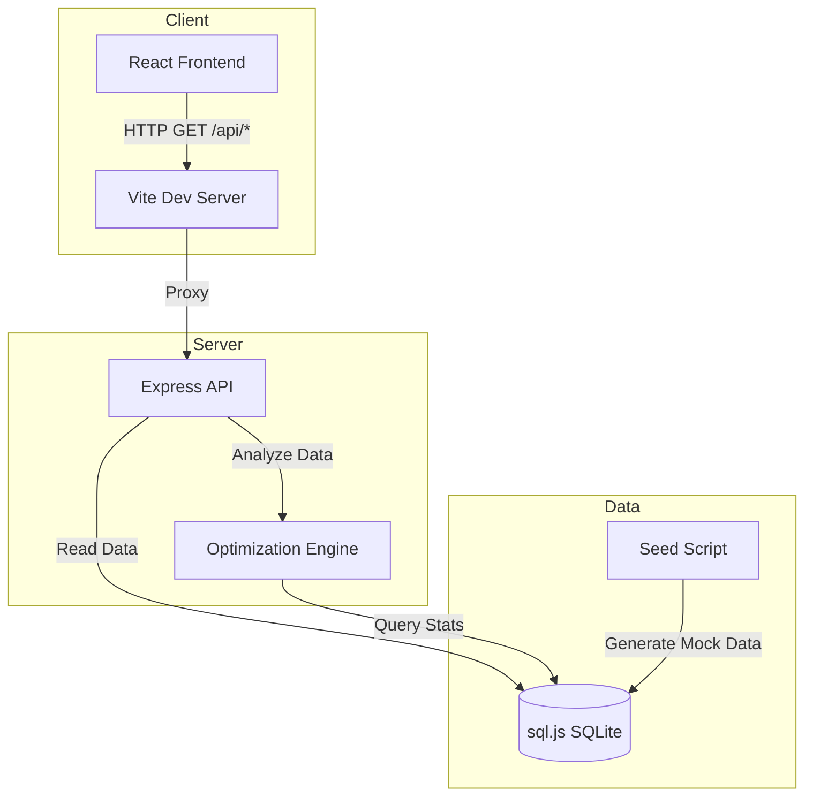

# CloudCost Dashboard

> **A professional multi-cloud cost visibility and resource optimization dashboard for engineering and finance ops.**

## Overview

Managing cloud spend across multiple providers often requires context-switching between different billing consoles, making it difficult to maintain a unified view of organizational costs. The CloudCost Dashboard solves this by aggregating billing data from AWS, GCP, and Azure into a single pane of glass, visualizing spending trends over a 90-day period.

Beyond simply displaying numbers, the core value proposition of this tool is its built-in **Optimization Engine**. Rather than just showing a high bill, the engine actively analyzes historical usage patterns to surface actionable savings opportunities—automatically identifying idle instances, flagging unexpected cost spikes, and recommending reserved instance commitments.

## Architecture



### Technology Choices
- **sql.js (SQLite)**: Chosen for absolute simplicity and portability. Using the WebAssembly port of SQLite means the backend requires no native C++ build tools, making local setup seamless across all operating systems.
- **Rule-based Engine (over ML)**: The optimization engine uses explicit rules rather than machine learning models. This provides 100% transparency—engineers are much more likely to action a recommendation if the exact math and threshold are visible, rather than relying on a "black-box" AI prediction.
- **React + Recharts**: React provides a highly modular, component-driven UI. Recharts offers declarative, highly customizable SVG charts tailored specifically for visualizing dense time-series financial data.
- **Tailwind CSS**: Enables a strict, custom design token system (specific typographic scales, neutral canvas colors, semantic alert colors) without maintaining separate fragmented stylesheets.

### Project Structure
```text
├── backend
│   ├── db
│   │   ├── database.js
│   │   ├── schema.sql
│   │   └── seed.js
│   ├── engine
│   │   └── optimizer.js
│   ├── routes
│   │   ├── costs.js
│   │   └── recommendations.js
│   ├── package.json
│   └── server.js
└── frontend
    ├── index.html
    ├── package.json
    ├── postcss.config.js
    ├── src
    │   ├── api
    │   │   └── client.js
    │   ├── components
    │   │   ├── FilterBar.jsx
    │   │   ├── KPICards.jsx
    │   │   ├── RecommendationsTable.jsx
    │   │   ├── ServiceBarChart.jsx
    │   │   └── SpendTrendChart.jsx
    │   ├── App.jsx
    │   ├── index.css
    │   └── main.jsx
    ├── tailwind.config.js
    └── vite.config.js
```

## Data Model

The foundational data model tracks daily resource spending and utilization.

```sql
CREATE TABLE IF NOT EXISTS billing (
  id INTEGER PRIMARY KEY AUTOINCREMENT,
  date TEXT NOT NULL,
  service TEXT NOT NULL,
  region TEXT NOT NULL,
  resource_id TEXT NOT NULL,
  cost REAL NOT NULL,
  usage_hours REAL NOT NULL,
  capacity_hours REAL NOT NULL DEFAULT 24
);
```

**Granularity:** One row represents the daily aggregate for a single cloud resource. This daily granularity strikes the optimal balance between database size and analytical power—it is fine enough to detect day-over-day cost spikes and daily utilization percentages, without the overwhelming volume and storage costs of hourly billing records.

**Coverage:** The system actively tracks 6 core services (EC2, S3, Lambda, RDS, GCP Compute, Azure VM) across 4 major regions (`us-east-1`, `us-west-2`, `eu-west-1`, `ap-southeast-1`).

## The Optimization Engine

The core of the backend is `optimizer.js`, which evaluates the raw billing data against four distinct heuristic rules to generate actionable recommendations.

| Rule | Condition | Savings Formula | Rationale |
|---|---|---|---|
| **IDLE** | `avg daily usage_hours < 5% of capacity_hours` | `avg daily cost × 30` | Resources running < 1.2 hours/day on average are likely abandoned or strictly ad-hoc, making them prime candidates for immediate termination. |
| **COST SPIKE** | `month-over-month cost increase > 30%` | `$0` (Informational) | A sudden 30% jump indicates a systemic change (e.g., runaway query, loop bug) requiring engineering investigation before it compounds. |
| **OVERSIZED** | `avg daily usage_hours between 5% and 20% of capacity` | `avg daily cost × 30 × 0.4` | Consistently low (but non-idle) usage suggests the resource is provisioned for peak loads that rarely occur; downsizing typically nets ~40% savings. |
| **RESERVED INSTANCE** | `3+ consecutive months ≥ 70% utilization` | `recent monthly cost × 0.2` | High, sustained baseline usage for a full quarter is the textbook indicator for a 1-year or 3-year RI commitment, safely netting ~20% savings. |

## API Reference

The Express API serves JSON data consumed by the React frontend.

### `GET /api/costs/summary`
Returns high-level KPI aggregations for the given timeframe.
**Response:**
```json
{
  "totalCost": 93047.05,
  "topService": {
    "name": "RDS",
    "cost": 29927.58
  },
  "byService": {
    "RDS": 29927.58,
    "EC2": 23821.11,
    "Azure VM": 18710.45,
    "GCP Compute": 16759.55,
    "S3": 2704.35,
    "Lambda": 1124.01
  },
  "byRegion": {
    "us-east-1": 33629.67,
    "us-west-2": 29290.57,
    "ap-southeast-1": 15502.82,
    "eu-west-1": 14623.99
  },
  "dateRange": {
    "startDate": "2025-04-09",
    "endDate": "2025-07-07"
  }
}
```

### `GET /api/costs/by-service`
Returns cost and usage aggregations grouped by service.
**Response:**
```json
[
  {
    "service": "RDS",
    "cost": 29927.58,
    "usage_hours": 6354.43
  },
  {
    "service": "EC2",
    "cost": 23821.11,
    "usage_hours": 5978.86
  }
]
```

### `GET /api/recommendations`
Triggers the optimization engine and returns actionable insights.
**Response:**
```json
[
  {
    "id": 2,
    "resource_id": "i-idle-001",
    "service": "EC2",
    "region": "us-east-1",
    "type": "idle",
    "estimatedSavings": 750,
    "message": "Resource i-idle-001 averages only 2.1% utilization (0.50h / 24h per day). Consider terminating this idle resource."
  }
]
```

## Results & Sample Output

Running the system against the 90-day seed data reveals the following insights:

- **Total 90-Day Cost:** $93,047.05
- **Top Spending Service:** RDS ($29,927.58)

**Optimization Results (34 total anomalies detected):**
- **Idle (2 flags):** Terminating the EC2 instance `i-idle-001` saves **$750.00/month**.
- **Oversized (1 flag):** Downsizing the GCP Compute instance `gcp-oversized-01` saves **$744.50/month**.
- **RI Candidate (16 flags):** Purchasing a reserved instance for `azure-vm-backup` saves **$98.52/month**.
- **Cost Spikes (15 flags):** The engine correctly detected that `azure-vm-backup` spiked 31% from April to May.

**Total Potential Savings:** **$2,890.49 per month**, representing approximately 9.3% of the monthly run rate in recoverable waste.

### Visual Interface


## Setup & Running Locally

1. **Clone the repository**
2. **Start the Backend**
   ```bash
   cd backend
   npm install
   
   # Initialize the SQLite database and generate the 90-day mock dataset
   node db/seed.js 
   
   # Start the Express server
   node server.js
   ```
3. **Start the Frontend** (In a new terminal)
   ```bash
   cd frontend
   npm install
   npm run dev
   ```
4. **Access the Dashboard**
   Navigate to `http://localhost:5173` in your browser.

## Deployment

The application is structured for modern PaaS deployment:
- **Backend (e.g., Render, Railway):** Deploy as a standard Node.js web service. The app utilizes `cors()` middleware to permit cross-origin requests. Ensure the `PORT` environment variable is mapped correctly. *Note: As it uses SQLite (`cloud_costs.db`), the database file is ephemeral on disk unless mounted on a persistent volume.*
- **Frontend (e.g., Vercel, Netlify):** Deploy as a static Vite site. Ensure that the proxy settings in `vite.config.js` or standard environment variables (`VITE_API_URL`) are configured to point to your live backend domain.

## Limitations & Future Work

**Current Limitations:**
- **Mock Data:** The database currently uses synthetically generated data via a seed script, rather than querying live cloud billing APIs.
- **Static Thresholds:** The optimization engine utilizes hard-coded, static thresholds (e.g., exactly 30% for a spike) which may not perfectly align with every organization's unique workload profiles.
- **State Persistence:** Dismissing a recommendation currently only removes it from the local frontend state; there is no persistent "dismissed/acknowledged" status saved back to the database.

**Future Work:**
1. **Live Cloud Integrations:** Build data ingestion pipelines connecting to the AWS Cost Explorer API and GCP Cloud Billing API for real-time organizational data.
2. **Dynamic ML Anomaly Detection:** Replace the static 30% MoM cost spike rule with a machine-learning-based time-series forecasting model (e.g., Prophet) to dynamically detect unusual spending behavior based on historical seasonality.
3. **Alerting System Integration:** Add webhook integrations to dispatch high-severity recommendations (like runaway cost spikes) directly to Slack, Microsoft Teams, or PagerDuty.
